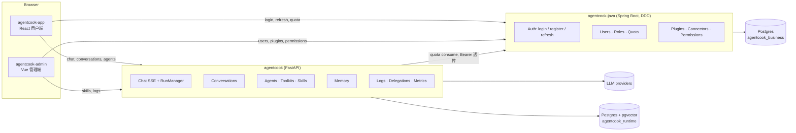
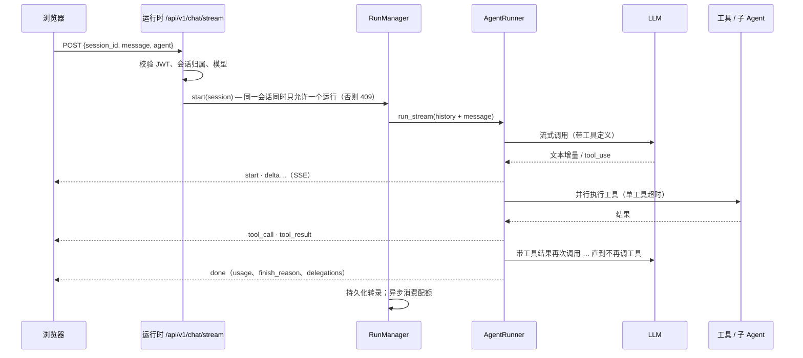

# AgentCook Architecture

AgentCook 由两个后端和两个前端组成：**Agent 运行时**（Python）负责"Agent 怎么想、怎么做"，**业务后端**（Java）负责"谁能用、能用多少"，两者靠同一把 JWT 密钥互信。

更细的图：[`docs/architecture/`](./docs/architecture/)。关键决策：[ADR-013 双后端](docs/adr/ADR-013-java-business-backend.md)、[ADR-018 配额与模型分层](docs/adr/ADR-018-chat-quota-tiered-models.md)、[ADR-020 Agent 循环与事件协议](docs/adr/ADR-020-agent-loop-and-event-protocol.md)。

## 1. 组件与边界



| 关注点                       | 归属                  | 说明                                                                                            |
| ---------------------------- | --------------------- | ----------------------------------------------------------------------------------------------- |
| 账号、密码、角色、签发 JWT   | Java                  | access token 带 `sub`（用户 UUID）、`roles`、`scope`、`typ=access`；refresh token `typ=refresh` |
| 校验 JWT                     | 两边                  | 同一 HS256 密钥；运行时拒绝 `typ=refresh`；`admin` 角色/scope 才能看全局日志、他人记忆          |
| 对话、运行、工具、技能、记忆 | 运行时                | 会话按用户隔离，访问他人会话返回 404                                                            |
| 免费额度                     | Java 记账，运行时消费 | 每轮完成后运行时调用 `POST /api/v1/quota/consume`（透传用户 token）                             |

## 2. 运行时内部

```
agentcook-core      AgentRunner（循环）· FunctionTool / @tool · Toolset · ContextWindow
                    AgentTool（委派）· RunHooks / ToolPolicy · SystemPromptBuilder
agentcook-providers OpenAI 兼容（Qwen/智谱/OpenAI）· Anthropic · FallbackProvider · MockProvider
agentcook-storage   PgConversationStore · PostgresMemoryStore（pgvector）· 嵌入器
agentcook           Settings → AppContainer（生命周期）→ ChatService → RunManager → SSE
```

- **AppContainer**（`container.py`）在应用启动时创建一次：读取 `Settings`、加载 Agent 规格（`agents/*.yaml`）、技能（`skills/*.md`）、工具包，连接存储并在需要时跑 Alembic 迁移。路由只从容器拿依赖，测试可以整体替换。
- **Agent 规格**是数据不是代码：名字、人设、可用工具包、技能、可委派的下属 Agent、轮数预算。默认 `assistant` 可委派 `researcher` 和 `analyst`。
- **每个（Agent，用户）一个实例**：记忆、Soul 互不串用；实例 ID = `{agent}-{sha256(user)[:16]}`。

## 3. 一轮对话的生命周期



- 运行**独立于 HTTP 连接**：浏览器断开不会中断运行，转录照常保存；`POST /api/v1/chat/runs/{run_id}/cancel` 才会取消，取消后已生成的部分以 `finish_reason=cancelled` 保存。
- SSE 每 15 秒发一次注释心跳，防代理超时。
- 帧协议（详见 ADR-020）：每帧都保留 v1 字段 `role` / `content` / `done`，`type` 取 `start` / `delta` / `tool_call` / `tool_result` / `done` / `error`，工具帧带 `tool_call` 对象（参数、状态、输出、耗时）。

## 4. 前端

- **用户端**（React + react-query + zustand）：`useAgentChat` 一个 reducer 管一整轮——文本增量、工具卡片按 id 更新、运行元数据；`stop()` 调取消接口。访问令牌过期时自动用 refresh token 换新并重试一次。运行时允许匿名（`AGENTCOOK_AUTH_MODE=optional`）时无需登录即可对话。
- **管理端**（Vue 3 + Element Plus）：用户/插件/权限走 Java，技能目录与实时日志（`/api/v1/logs/stream?follow=true`）走运行时。

## 5. 部署形态

| 形态       | 入口                                       | 说明                                                        |
| ---------- | ------------------------------------------ | ----------------------------------------------------------- |
| 本地开发   | `make run` + `make web`                    | Mock 模型 + 内存存储，无需 Docker；`make dev` 起全部中间件  |
| 单容器     | `agentcook/Dockerfile`                     | 生产模式默认强制鉴权、拒绝开发密钥                          |
| 微服务     | `agentcook-swarm/docker-compose.swarm.yml` | Traefik 按路径分流两个后端；gRPC ChatService；etcd 服务发现 |
| Kubernetes | `deploy/helm`                              | 两个后端共享同一个 JWT Secret                               |

## 6. 测试

| 层     | 工具                                                | 覆盖                                                                     |
| ------ | --------------------------------------------------- | ------------------------------------------------------------------------ |
| 单元   | pytest / vitest / JUnit                             | Agent 循环每个分支、工具系统、提供方转换、路由、前端 reducer 与 SSE 解析 |
| 集成   | testcontainers（pgvector、Redis）、Spring Boot Test | 会话与记忆持久化、迁移、Java 持久化与接口                                |
| 契约   | Pact                                                | 用户端/管理端对运行时的期望，在 CI 中对真实运行时本地校验（无需 broker） |
| 端到端 | Playwright                                          | 真实运行时 + Mock 模型：工具调用、委派、停止、持久化、删除会话           |
| Schema | schemathesis                                        | 按 OpenAPI 对运行时做属性测试                                            |
